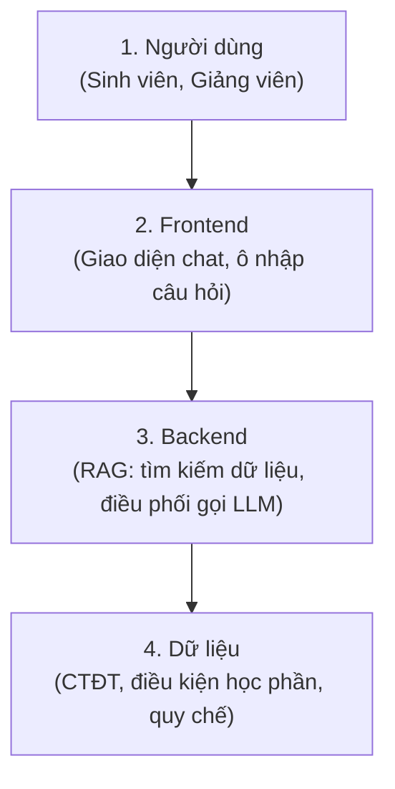

# TỔNG HỢP YÊU CẦU & ĐỊNH HƯỚNG CỦA GIẢNG VIÊN HƯỚNG DẪN (ĐỒ ÁN 1)

> **Giảng viên hướng dẫn:** Thầy Bùi Tiến Cường  
> **Sinh viên thực hiện:** Mai Duy Hiếu - MSSV: 20223967  
> **Học phần:** Đồ án 1 (Học kỳ 2026.1) - Viện Điện tử - Viễn thông / ĐHBK Hà Nội  
> **Nguồn tư liệu gốc:** Các email hướng dẫn (`docs/mail/`) và sơ đồ kiến trúc định hướng (`docs/theory/`)  

---

## 1. Bối cảnh & Các hướng đề tài Thầy gợi ý ban đầu

Vào ngày **13/09/2026 (17:44)**, Thầy Bùi Tiến Cường đã gửi email định hướng cho sinh viên 3 hướng đề tài có tính ứng dụng cao thực tế tại ĐHBK Hà Nội *(Nguồn: `docs/mail/topics.png`)*:

1. **Đề tài 1: Hệ thống quản lý đồ thất lạc (Lost & Found)**
   - *Mô tả:* Sử dụng AI để so sánh hình ảnh đồ vật thất lạc và văn bản mô tả để ghép nối người mất và người nhặt được.
2. **Đề tài 2: Hệ thống hỏi đáp quy chế đào tạo, học phí, học bổng của ĐHBK Hà Nội**
   - *Bối cảnh đặt ra:* Việc tìm kiếm, tra cứu thông tin quy chế, học phí, học bổng trên website nhà trường hiện tại còn rất khó khăn, phân tán.
   - *Đối tượng phục vụ:* Sinh viên (SV), Giảng viên (GV), Phụ huynh học sinh.
   - *Định hướng công nghệ Thầy đề xuất:* Xây dựng **Web App + Chatbot + RAG (Retrieval-Augmented Generation) + Document DB**.
3. **Đề tài 3: Hệ thống Chatbot tư vấn chọn môn học dựa trên CTĐT và điều kiện đăng ký**
   - *Mô tả:* Chatbot hỗ trợ sinh viên lên kế hoạch học tập, chọn môn học kỳ tới dựa theo khung Chương trình Đào tạo (CTĐT) và các điều kiện ràng buộc học phần (tiên quyết, học trước, song hành).

👉 **Lựa chọn triển khai thực tế của sinh viên:**  
Nhận thấy nhu cầu cấp thiết của sinh viên vừa cần tra cứu quy chế học tập/học phí/học bổng (Đề tài 2), vừa cần hỗ trợ chọn môn và kiểm tra điều kiện tiên quyết (Đề tài 3), sinh viên đã đề xuất và triển khai **kết hợp cả hai đề tài thành một hệ sinh thái đồng nhất**: **"HUST Course Advisor & Degree Audit Engine"** (tập trung thí điểm cho ngành Kỹ thuật Điện tử Viễn thông - ET1).

---

## 2. Chi tiết các yêu cầu & Chỉ đạo kỹ thuật của Thầy

Trong email trao đổi tiếp theo *(Nguồn: `docs/mail/counsel.png`)*, Thầy đã phản hồi và đưa ra các chỉ đạo chuyên môn cụ thể:

### 2.1. Về phạm vi đề tài và dữ liệu (Data-Centric)
* **Ý kiến của Thầy:** *"Mình nghĩ là tư vấn cho chỉ SV Điện tử hay sinh viên toàn trường thì không khác nhau mấy. Quan trọng là tài liệu của em thu thập được sẽ như nào thôi."*
* **Yêu cầu rút ra:** 
  - Về mặt kiến trúc kỹ thuật, giải pháp cho 1 ngành hay toàn trường là tương đương nhau.
  - **Khâu cốt lõi quyết định chất lượng:** Khâu **thu thập, làm sạch và cấu trúc dữ liệu**. Dữ liệu tài liệu (quy chế, CTĐT, đề cương) phải đầy đủ, chuẩn xác và có cấu trúc tốt thì Chatbot/RAG mới trả lời chính xác, tránh hiện tượng ảo giác (hallucination).

### 2.2. Về kiến trúc công nghệ & Mô hình AI
* **Ý kiến của Thầy:** *"Em tìm hiểu cách xây dựng chatbot với RAG + gemini hoặc mấy con AI cho free APIs tương tự nhé. Có gì khó khăn khi trao đổi mình."*
* **Yêu cầu kỹ thuật:**
  - Ứng dụng kỹ thuật **RAG (Retrieval-Augmented Generation)**: Không chỉ dùng LLM sinh văn bản tự do, mà phải có bước truy xuất dữ liệu từ kho tài liệu trường để cung cấp ngữ cảnh cho mô hình.
  - Sử dụng **Google Gemini API** (hoặc các AI model có Free Tier/API tương tự) để tối ưu chi phí vận hành thử nghiệm và dễ dàng mở rộng.

### 2.3. Sơ đồ kiến trúc luồng xử lý do Thầy định hướng
Theo sơ đồ phác thảo định hướng *(Nguồn: `docs/theory/image.png`)*, hệ thống cần đảm bảo tối thiểu 4 tầng kiến trúc:

---

## 3. Bảng đối chiếu: Hiện thực hóa yêu cầu của Thầy vào Dự án

Dưới đây là bảng tổng hợp cách dự án đã đáp ứng và cụ thể hóa các chỉ đạo từ Thầy:

| STT | Yêu cầu / Gợi ý của Thầy | Hiện thực hóa trong mã nguồn dự án | Vị trí mã nguồn |
| :--- | :--- | :--- | :--- |
| **1** | **Web App + Chatbot** | Giao diện Single Page Application (React 19 + CSS) với cửa sổ chat tự nhiên, hỗ trợ Markdown và lưu lịch sử hội thoại. | `project/frontend/src/` |
| **2** | **Xây dựng RAG + Gemini** | Tích hợp pipeline RAG: Document Loader chia nhỏ văn bản (Chunking) $\rightarrow$ Vector Embeddings lưu trữ tại ChromaDB $\rightarrow$ Google Gemini API (mặc định `gemini-2.5-flash`) trả lời kèm trích dẫn. Khi không có API key, hệ thống chuyển sang chế độ trích xuất cục bộ có dẫn nguồn. | `project/backend/app/rag/` |
| **3** | **Thu thập dữ liệu CTĐT & Quy chế** | Kho RAG tin cậy gồm 5 tài liệu đã đối chiếu: CTĐT ET1 năm 2022 và 2023, Quy chế đào tạo 2025, Sổ tay sinh viên 2026 và Quyết định học phí 2025–2026. Ba bản nháp cũ được gắn `RAG_STATUS: UNVERIFIED` và không được lập chỉ mục. | `project/data/documents/` |
| **4** | **Tư vấn chọn môn dựa trên CTĐT & Điều kiện ĐK** | Chức năng cốt lõi dùng Rule Engine để kiểm tra điều kiện tiên quyết, học trước, song hành và tư vấn lựa chọn môn. Graph/Ripple Effect là phần mở rộng nội bộ, không đưa vào giao diện MVP. | `project/backend/app/engine/rule_engine.py` |
| **5** | **Rà soát quy chế & Bổ sung Dashboard (phần mở rộng của sinh viên)** | Xây dựng thêm Rule Engine mô phỏng quy chế HUST (tính CPA, kiểm tra cảnh cáo mức 1/2/3, hạn mức tín chỉ được đăng ký) và Tab Degree Audit trực quan hóa tiến độ tích lũy 126 tín chỉ tốt nghiệp. | `project/backend/app/engine/rule_engine.py` & `project/frontend/src/components/AuditTab.jsx` |

---

## 4. Tóm tắt các điểm cần lưu ý khi Báo cáo với Thầy

Khi trình bày hoặc báo cáo định kỳ với Thầy Bùi Tiến Cường, cần nhấn mạnh vào các trọng tâm sau:

1. **Khâu xử lý Dữ liệu (Đúng như Thầy dặn):** 
   - Chứng minh dữ liệu đã được làm sạch, tách đoạn chuẩn (Chunking theo từng Điều/Khoản trong quy chế và từng môn học trong CTĐT).
   - Chatbot khi trả lời luôn dẫn nguồn: *"Căn cứ theo Điều... Quyết định Quy chế đào tạo..."*.
2. **Khả năng giải quyết bài toán tư vấn môn học (CTĐT & Điều kiện ĐK):**
   - Trực tiếp demo kịch bản hỏi đáp với từ lóng của sinh viên (VD: "vxl", "dts", "vi mạch", "ckđt").
   - Có thể giới thiệu Graph/Ripple Effect như hướng mở rộng sau MVP nếu còn thời gian; không xem đây là yêu cầu bắt buộc của đề tài.
3. **Hiệu năng & Tối ưu:** 
   - Giải thích việc dùng Hybrid AI: Các câu hỏi về dữ liệu cố định (tiên quyết, số tín chỉ, công thức tính CPA) được xử lý bằng thuật toán Deterministic Code (Graph/Rule Engine) để đảm bảo chính xác 100% và tiết kiệm token; chỉ các câu hỏi ngữ nghĩa, tra cứu quy chế mới chuyển qua RAG + Gemini LLM.
